# Taskia — Recorrido actual (capturas)

Documentación corta de **cómo se ve y se recorre** la plataforma hoy. Las capturas se tomaron de la app en local. El detalle de reglas está en [FUNCIONES.md](../FUNCIONES.md).

---

## 1. Entrada

Cualquier rol llega a la misma puerta. Usuario y contraseña (cuentas demo: explorador `Seroven`, guardián `Claudia`, admin `Sebastian`).

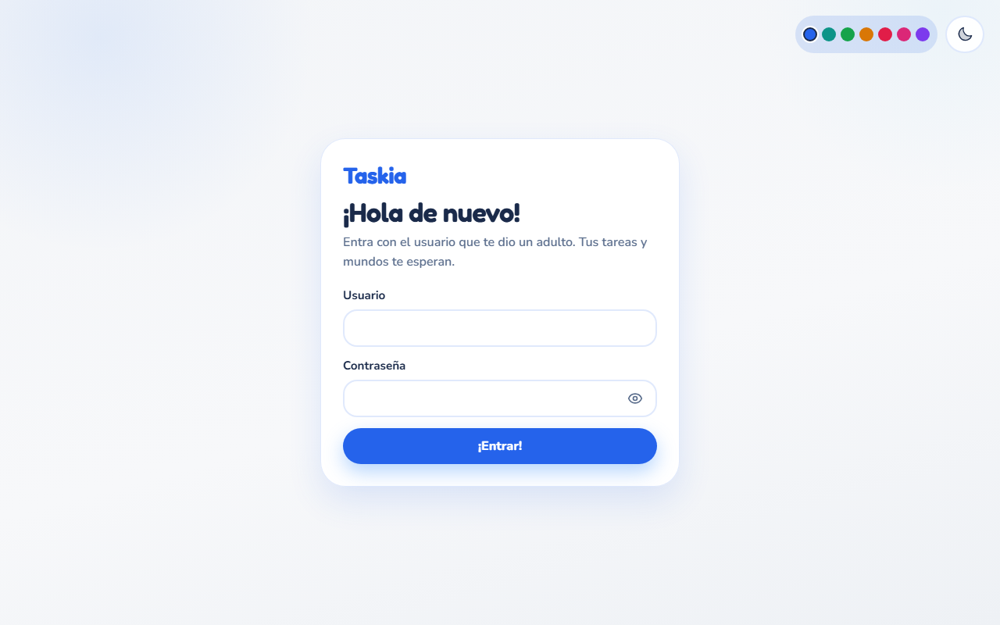

---

## 2. Explorador — Hub

Tras entrar, el explorador elige a dónde ir. **Tripulación** está cerrada a propósito. **Mundos** y **Campamento** están abiertos.

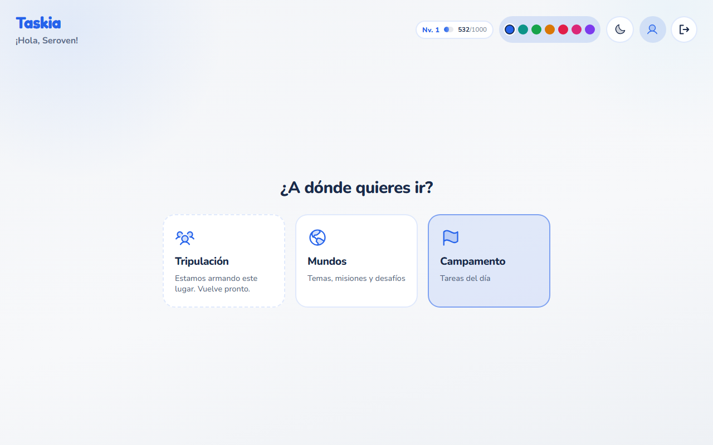

---

## 3. Campamento — Hoy y Proyectos

Lista del día (diarias) y pestaña de proyectos. Se agregan tareas, se marca Listo o se entra a estudiar con Taskia.

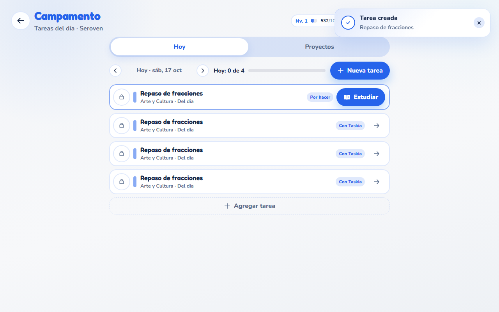

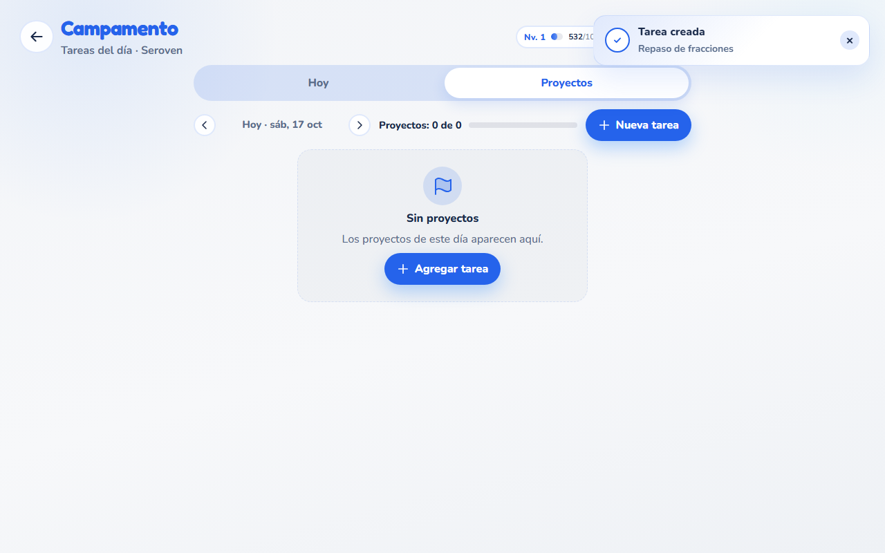

---

## 4. Estudio con Taskia

Desde una tarea con ayuda, el chat abre en fase de entendimiento. Texto, Hablar o Foto.

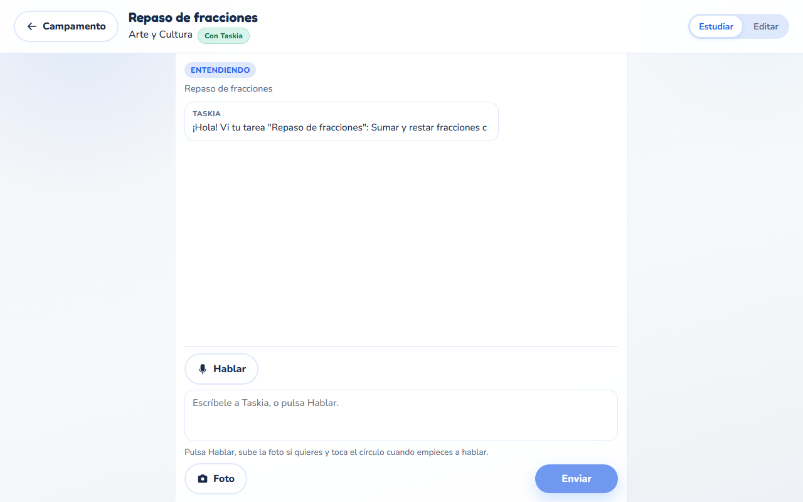

Al pulsar **Hablar**, el micrófono se abre al lado del chat: se toca el círculo para hablar y Taskia responde en voz.

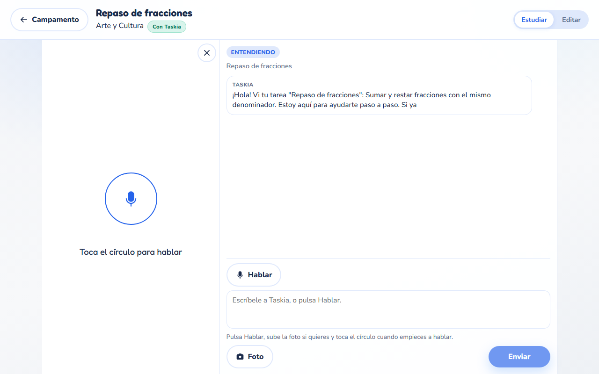

---

## 5. Mundos

Temas, cursos, misiones y desafíos. Primero la lista, luego el detalle del mundo y el del curso.

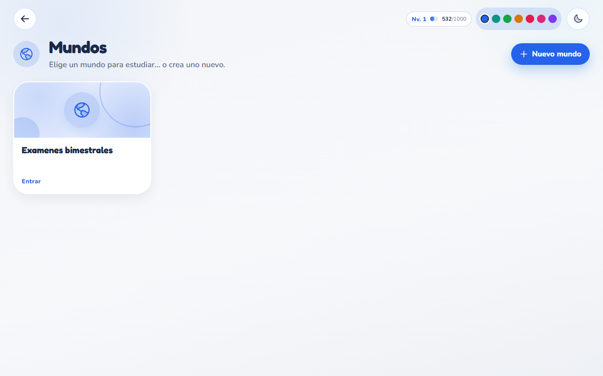

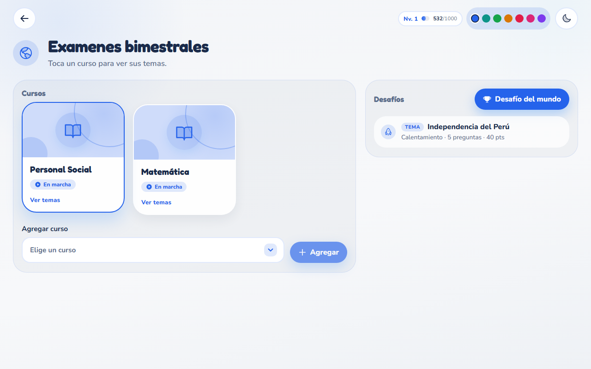

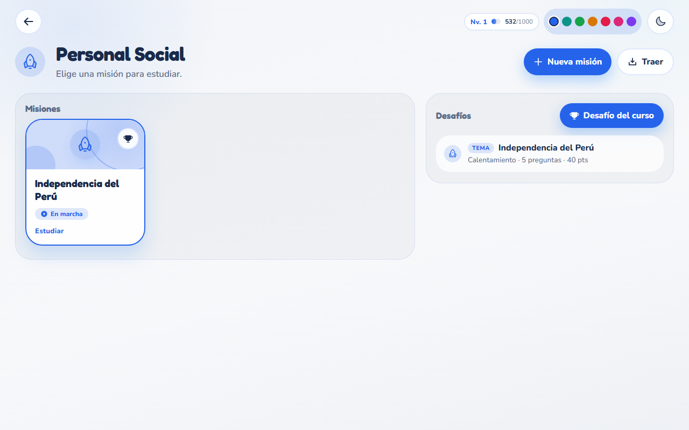

Un desafío ya hecho se abre en su detalle: puntaje y cada pregunta con lo que se respondió.

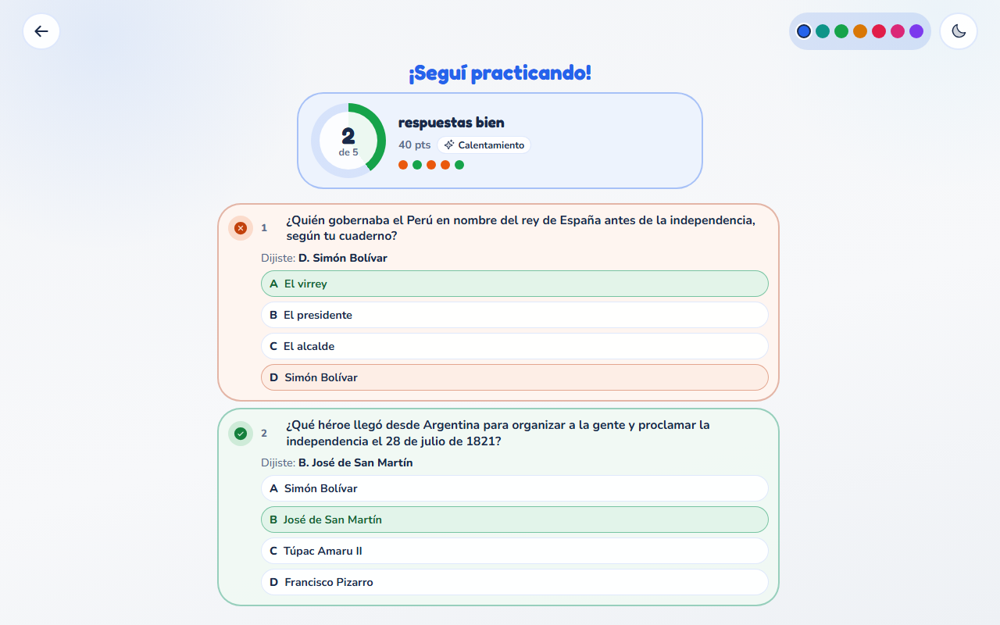

Al empezar uno nuevo, Taskia no habla: una pregunta a la vez, con reloj y avance.

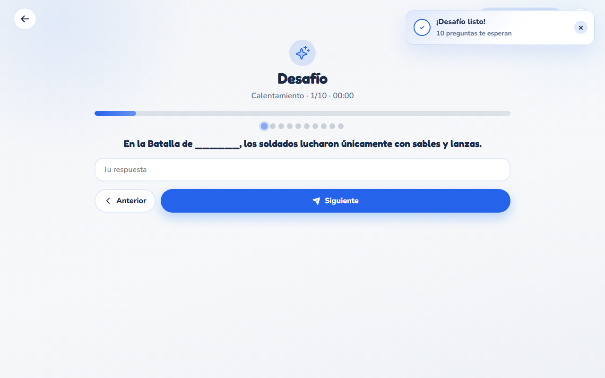

---

## 6. Guardián

Panel del adulto: chat del día a la izquierda; nivel, tripulación y avisos a la derecha. Cambia de explorador con los chips.

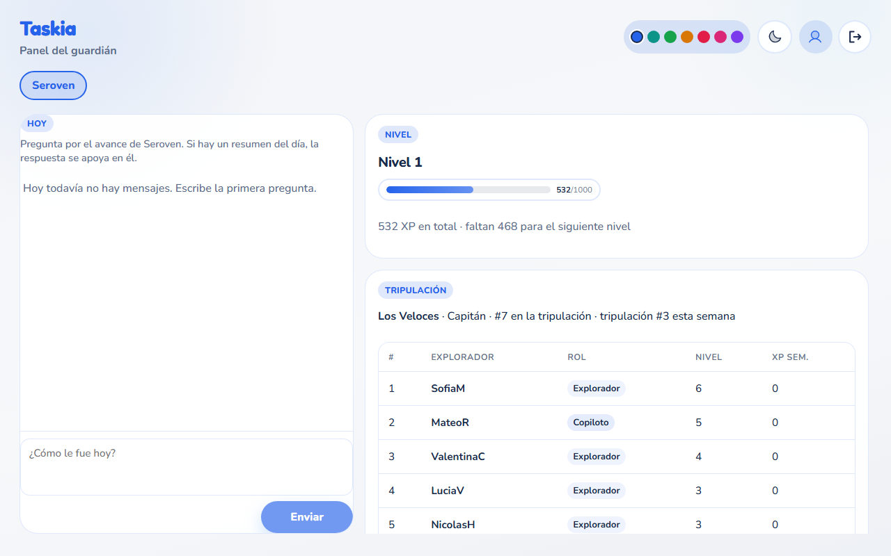

---

## 7. Administrador

Resumen del sistema y alta de **Guardianes y Exploradores** (vínculo obligatorio).

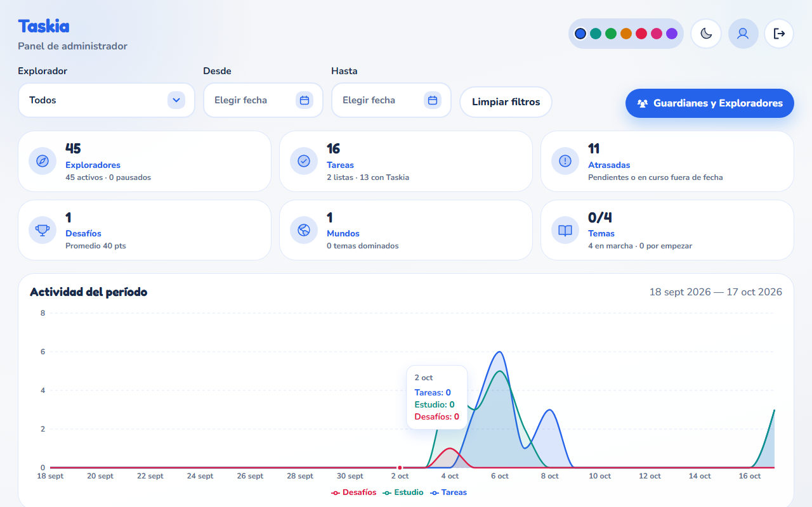

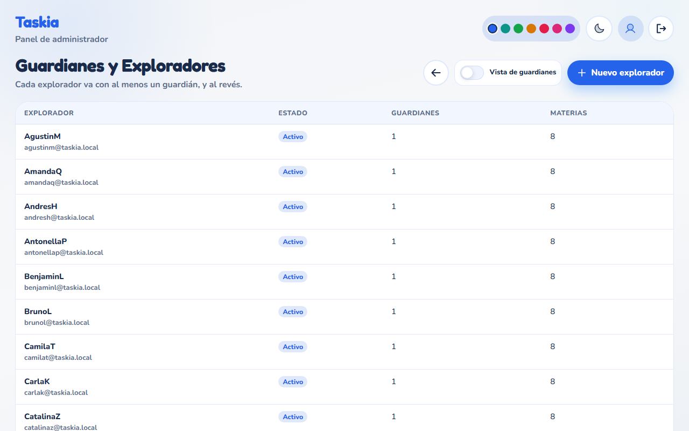

---

## Mapa rápido

```
Login
 ├─ Explorador → Hub → Campamento → Estudio
 │                 └→ Mundos → Mundo → Curso → (misión / desafío)
 ├─ Guardián → Panel (chat + progreso del explorador)
 └─ Admin → Panel → Guardianes y Exploradores
```

Para regenerar las capturas (con front y back en marcha):

```bash
node docs/producto/recorrido/capture.mjs
```
